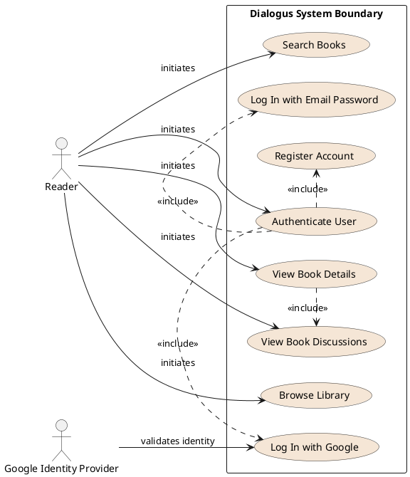
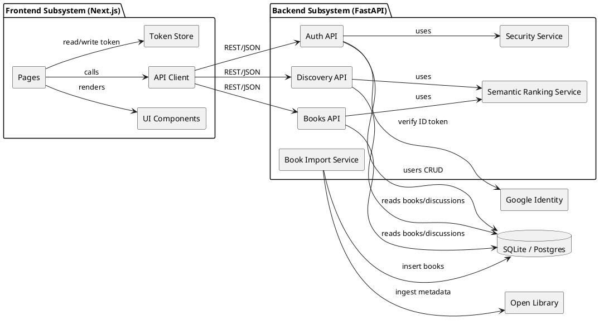
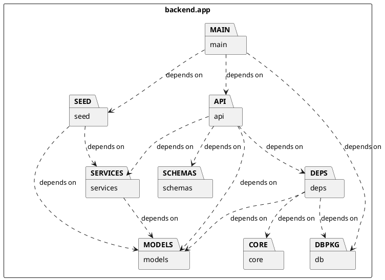
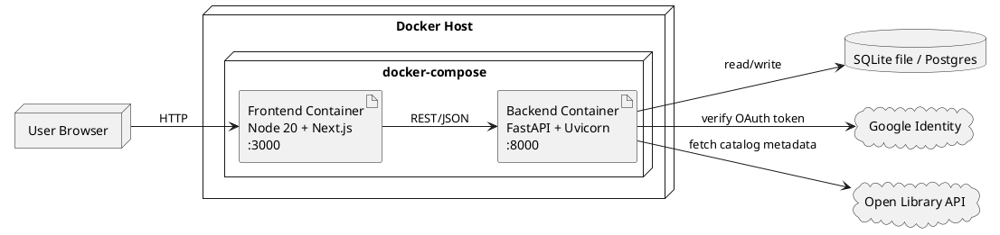
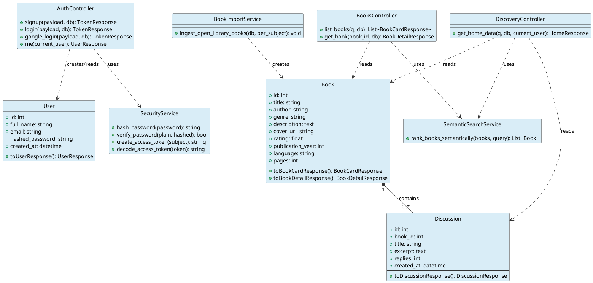
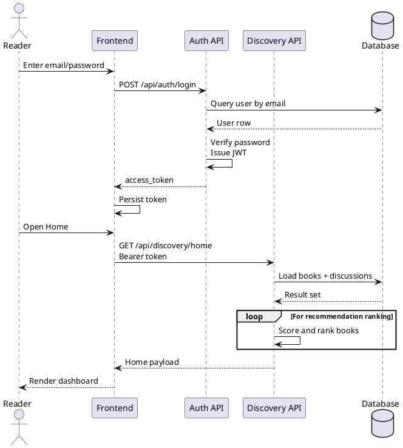
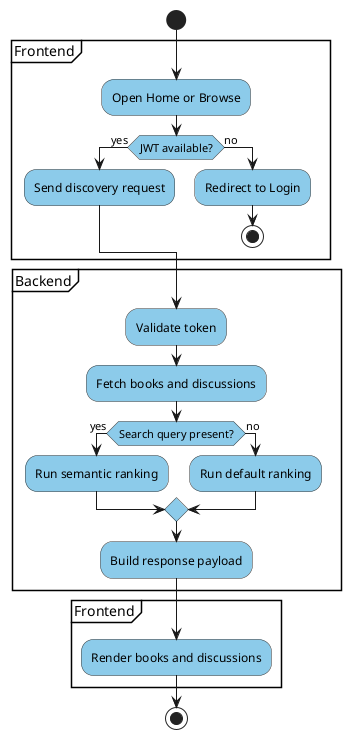

# Dialogus Architecture

## Architecture Chosen

Dialogus uses a Layered Modular Monolith architecture.

### Explanation

The system is implemented as one deployable backend service (FastAPI) and one frontend web app (Next.js), with clear internal module boundaries:
- API layer: request handling and HTTP contracts
- Application/service layer: ranking and import logic
- Data access layer: SQLAlchemy models and DB session handling
- Presentation layer: frontend pages/components that consume backend APIs

This architecture was chosen because it gives:
- Fast development for an early product iteration
- Low operational complexity compared to microservices
- Clear separation of concerns inside one codebase
- Easy path to scale later (move to Postgres, add cache, split services if needed)

## UML Diagrams

### 1. Use Case Diagram

### 2. Component Diagram

### 3. Package Diagram

### 4. Deployment Diagram

### 5. Class Diagram (Domain and Service Classes)

### 6. Sequence Diagram (Login and Home Load)

### 7. Activity Diagram (Book Discovery)

